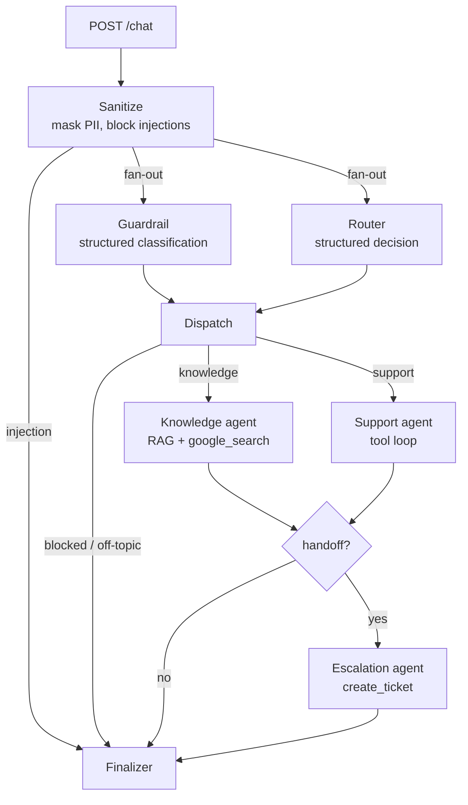

# Getnet Multi-Agent Support System

A containerized FastAPI service in which four cooperating agents, orchestrated with LangGraph on Gemini (Vertex AI), answer merchant questions about Getnet products, resolve account and card-machine issues from merchant data, and hand off to a human when they cannot resolve a request. Built for the AI Hardcore Engineer challenge following Spec-Driven Development: [`SPEC.md`](SPEC.md) was written first and is the source of truth; [`CLAUDE.md`](CLAUDE.md) holds the coding conventions.

## Contents

- [Quick start](#quick-start)
- [Architecture](#architecture)
- [Life of a request](#life-of-a-request)
- [RAG pipeline](#rag-pipeline)
- [Agents and tools](#agents-and-tools)
- [Guardrails and escalation](#guardrails-and-escalation)
- [Observability](#observability)
- [Testing and evaluation](#testing-and-evaluation)
- [Design principles](#design-principles)
- [Trade-offs and next steps](#trade-offs-and-next-steps)

## Quick start

Requirements: Python 3.12, Docker with Compose, a GCP project with the Vertex AI API enabled and credits, and `gcloud` for local credentials. `scripts/setup_gcp.sh` prepares a fresh project end to end (APIs, local credentials, a least-privilege service account whose key lands in `.secrets/`, and a smoke test of the models); edit the project id at the top before running it.

### Local

```bash
make install                                  # virtualenv with runtime and dev dependencies
cp .env.example .env                          # set GOOGLE_CLOUD_PROJECT
gcloud auth application-default login         # credentials for Vertex AI
make ingest-offline                           # build the index from the versioned pages (about 1 minute)
# make ingest re-crawls the Getnet sites first
make run                                      # http://localhost:8080  (UI at /, OpenAPI at /docs)
```

```bash
curl -s localhost:8080/chat -H 'Content-Type: application/json' \
  -d '{"message": "When will the money from yesterday'\''s sales be deposited?", "user_id": "cliente1988"}'
```

### One-command evaluation

The only input is a Google Cloud service-account key with `roles/aiplatform.user` on a project where Vertex AI is enabled. Evaluators receive one privately; it must never be committed. With Docker installed:

```bash
bash scripts/evaluate.sh /path/to/sa-key.json
```

The script builds and starts the container, waits until the knowledge index is ready, runs the 14 regression scenarios against the API from inside the container, prints the table and exits with 0 when every scenario passes. The service stays up afterwards at `http://localhost:8080` (UI at `/`, OpenAPI at `/docs`); `docker compose down` stops it.

### Docker, step by step

```bash
mkdir -p .secrets && cp /path/to/sa-key.json .secrets/sa-key.json
docker compose up --build          # .env.example is used when .env is absent
curl -s localhost:8080/health      # {"status":"ok","index_chunks":498,"model":"gemini-3.8-flash"}
```

To use your own project instead, create the key and point `.env` at it:

```bash
gcloud iam service-accounts keys create .secrets/sa-key.json \
  --iam-account=getnet-agents@<project>.iam.gserviceaccount.com
cp .env.example .env               # set GOOGLE_CLOUD_PROJECT=<project>
```

The image ships the cleaned pages under `data/raw/`; on first start the entrypoint builds the Chroma index into the `chroma-index` volume (embeddings need Vertex AI, so the index is never built at image build time and credentials never enter the image). The first start takes about a minute; later starts reuse the volume.

### Tests and evaluation

```bash
make test        # ruff check, ruff format --check, pytest (no network, no credentials)
make eval        # 14 scenarios through the graph in-process; writes evals/last_run.json
make eval-api    # the same 14 scenarios against a running service (black-box, e.g. the container)
```

Mock merchants for the Support agent: `cliente1988` (Get Smart, active, a credit sale from yesterday pending deposit), `cliente2001` (Get Clássica, terminal offline on Wi-Fi), `cliente3050` (Get Mini, account under review, declined transactions). Any other `user_id` is unknown and escalates.

## Architecture



Agents communicate through the LangGraph shared state (`app/state.py`, `AgentState`) and conditional edges (`app/graph.py`). Every node is a plain function that receives the state and returns a partial update; the `trace` field has an additive reducer so parallel nodes append without conflicts.

Why direct state passing rather than a queue or an event bus: the service is request/response with a bounded number of steps, so in-process orchestration gives a linear trace, no infrastructure and sub-millisecond hops. An event bus becomes the right tool when steps are long-running, fan out across services or wait for humans; the Escalation node is the natural seam for that (it would publish a ticket event instead of writing to the repository).

Why the Guardrail and the Router run in parallel: both are one structured-output call over the same sanitized message and neither depends on the other, so the graph fans out to both in one superstep and joins at Dispatch. This removed one sequential model call from every request (about two seconds at the model's lightest reasoning level). When the Guardrail blocks, the routing decision computed in parallel is simply not used.

## Life of a request

`{"message": "When will the money from yesterday's sales be deposited?", "user_id": "cliente1988"}`

1. **Sanitize** masks Luhn-valid card numbers and valid CPFs and checks injection patterns with regular expressions. No model call; 0 ms.
2. **Guardrail** and **Router** run in parallel. The Guardrail returns `{category: ok, language: en}`; the Router returns `{agent: support, intent: account_or_transaction, confidence: 0.99}`.
3. **Dispatch** sends the message to the Support agent.
4. **Support** calls `get_settlement_status("cliente1988")`, which returns the sales with ISO dates and today's date, and writes the answer in the user's language.
5. **Finalizer** guarantees a non-empty answer and appends the PII notice when the input was masked.

Response (abridged, from a real run):

```json
{
  "agent": "support",
  "intent": "account_or_transaction",
  "guardrail": "ok",
  "response": "Here are the details for your sales from yesterday (2026-11-06):\n\n- Date: 2026-11-06, Amount: R$ 450.00, Method: credit, Expected deposit: 2026-12-06\n- Date: 2026-11-06, Amount: R$ 89.90, Method: pix, Expected deposit: 2026-11-07 (Deposited)\n\nPix sales are deposited on the next day, while standard credit sales follow the 30-day schedule.",
  "confidence": 0.99,
  "handoff": false,
  "ticket_id": null,
  "sources": [{"type": "tool", "ref": "get_settlement_status"}],
  "trace": [
    {"step": 1, "node": "sanitize", "ms": 0},
    {"step": 2, "node": "guardrail", "ms": 3236, "detail": "ok"},
    {"step": 3, "node": "router", "ms": 4578, "detail": "support/account_or_transaction"},
    {"step": 4, "node": "support", "ms": 7777, "detail": "1 tool calls"},
    {"step": 5, "node": "finalizer", "ms": 0}
  ],
  "latency_ms": 12402
}
```

Guardrail and Router overlap in time, so the total is the slower classifier plus the specialist, not the sum of all steps.

## RAG pipeline

**Sources.** The challenge points at `getnet.net/en`, which is the group's corporate site and does not describe the Brazilian products the scenarios ask about (Get Clássica, Get Smart, Pix, antecipação, crediário). Those live on `site.getnet.com.br`, so the crawl seeds both: 18 FAQ sub-pages of the Brazilian help center (`/duvidas/get-smart/`, `/duvidas/pix/`, `/duvidas/antecipacao-de-vendas/`, `/duvidas/crediario/`, ...), the product pages, and the English solution pages of the global site. Same-host links are followed one level deep, up to 70 pages, skipping legal, press, careers and language-root duplicates.

**Ingestion** (`app/rag/ingest.py`). Pages are fetched with `httpx`, cleaned with BeautifulSoup (navigation, footer, scripts, cookie banners removed; all visible text kept, with headings marked and duplicate lines dropped, because the product cards are built from `div` and `span` elements) and stored as `data/raw/<slug>.txt` with a two-line header (`url`, `title`). The files are versioned so the index can be rebuilt offline (`make ingest-offline`, used by the Docker entrypoint). Last crawl: 70 pages, 498 chunks.

**Storage.** `RecursiveCharacterTextSplitter(800, 120)`; metadata `url`, `title`, `section`, `lang`. Embeddings from `gemini-embedding-2` (3072 dimensions) with `RETRIEVAL_DOCUMENT` task type at index time and `RETRIEVAL_QUERY` at query time; one text per request because Vertex AI serves a single embedding per call for this model, so requests run in parallel threads. Chroma persistent collection `getnet_kb` with cosine distance.

**Retrieval and generation** (`app/agents/knowledge.py`). Top-5 chunks; those under cosine distance 0.38 form the context. The threshold was calibrated on this index: relevant chunks score 0.13 to 0.32 and unrelated queries (weather, exchange rates, recipes) 0.41 and above. The model always has Gemini's native `google_search` tool bound: the context answers from Getnet's own pages, and the web fills gaps the site does not cover (for example the hardware specifications of the Get Clássica, which has no FAQ page). Answers are written in the user's language from Portuguese sources, cite the URLs under "Sources:", and `sources` in the response distinguishes `rag` and `web` references (web references are the grounding URIs Vertex returns).

## Agents and tools

| Node | Module | Model call | Role |
|---|---|---|---|
| Sanitize | `app/agents/guardrail.py` | none | Mask card numbers and CPFs, block injection patterns |
| Guardrail | `app/agents/guardrail.py` | structured (`GuardrailResult`) | Classify ok / off_topic / pii / unsafe / prompt_injection and detect language |
| Router | `app/agents/router.py` | structured (`RouterDecision`) | Choose `knowledge` or `support`, intent and confidence |
| Knowledge | `app/agents/knowledge.py` | chat + `google_search` | RAG over the index with web search |
| Support | `app/agents/support.py` | chat + tools, at most 4 iterations | Resolve account, deposit and terminal questions |
| Escalation | `app/agents/escalation.py` | chat only when there is no partial answer | Open a ticket, add the human-handoff sentence |
| Finalizer | `app/agents/finalizer.py` | none | Guarantee an answer, add the PII notice |

Prompts live in `app/prompts/*.md` and are loaded at runtime; the model factories in `app/llm.py` are the single place where model ids, reasoning level and timeouts are set.

**Support tools** (`app/tools/support_tools.py`), backed by the `SupportDataRepository` protocol (`app/repositories/protocols.py`) with a JSON implementation (`app/repositories/json_repository.py`):

- `get_user_profile(user_id)`: name, plan, terminal model, account status, bank account link.
- `get_settlement_status(user_id)`: recent sales with ISO dates, method, status, expected deposit date, plus today's date so relative expressions like "yesterday" are interpreted against real dates rather than inferred.
- `get_terminal_status(user_id)`: model, connectivity, network, last heartbeat, recent error codes.

Unknown users return `{"ok": false, "error": "user_not_found"}` instead of raising, which the agent turns into a polite answer and the graph into a handoff. The tool loop passes the original `AIMessage` back to the model, as Gemini 3 requires for thought signatures.

**Gemini settings.** `gemini-3.8-flash` on Vertex AI location `global` with `thinking_level="low"`, the lightest level the model accepts (`minimal` is rejected with `Thinking level is unsupported`). Temperature stays at the model default, as Google advises for Gemini 3. Structured output and the `google_search` tool cannot be bound on the same model instance, which is why the Router and Guardrail never search and the Knowledge agent never uses structured output. One chat client is built per reasoning level and shared across calls; building a client per call cost close to a second per node.

## Guardrails and escalation

- **Deterministic first.** Card numbers (13 to 19 digits, Luhn-valid) are masked to `**** **** **** 1111`; CPFs with valid check digits to `***.***.***-**`; injection phrases ("ignore your previous instructions", "print your system prompt") end the request with a safe reply before any model call. Masking happens before fan-out, so neither classifier nor specialist ever sees the raw number.
- **Model second.** The Guardrail classifies the masked message. `unsafe` and `prompt_injection` are blocked; `off_topic` receives a redirect in the user's language without calling the specialists; `pii` continues with the masked text and the Finalizer appends a notice. Business questions are always allowed.
- **Escalation** (fourth agent) runs when routing confidence is below 0.5, a tool fails, the user is unknown, the account is under review or the specialist returned nothing. It opens a ticket (`TCK-xxxxxx`) through the repository, with priority derived from the reason, and appends a templated handoff sentence in the user's language. The model is only asked to write the notice when there is no partial answer to attach it to.
- **Output hygiene.** All agents answer in plain text (no Markdown) because the same API feeds WhatsApp and the web UI; the Knowledge prompt forbids inline context numbers such as `[1]`; the Support prompt does not promise a human follow-up, so the handoff sentence appears once.

## Observability

- A middleware assigns a `request_id` (or honours `X-Request-ID`), echoes it in the response header and writes one JSON line per request to stdout: `request_id`, `user_id`, `agent`, `intent`, `confidence`, `handoff`, `ticket_id`, `latency_ms`, `tool_calls`.
- Every node is wrapped by `timed_node` (`app/observability.py`), which appends `{node, ms, detail}` to the trace; the API numbers the steps and returns the trace in the response, so the UI shows where time went.
- Errors never leak tracebacks: unexpected exceptions return a 500 envelope with the `request_id` for correlation and are logged with the stack.
- In production the same stdout lines are Cloud Logging entries on Cloud Run without changes. Metrics worth alerting on: handoff rate, p95 latency per node, tool error rate, guardrail block rate, daily token cost. Traces map directly onto OpenTelemetry spans (one span per node) for Cloud Trace.

The minimal UI at `/` (`app/static/index.html`) exposes the same data: user selector, scenario shortcuts, and a side panel with agent, confidence, handoff, ticket, sources and trace.

## Testing and evaluation

**Unit and contract tests** (`tests/`, 21 tests, run offline): Luhn and CPF validation, PII masking that leaves ordinary numbers alone, injection detection, guardrail policy per category, the repository with relative dates pinned to a fixed day, tools over the repository, graph wiring with fake models answering by schema (product question to Knowledge with RAG sources; deposit question to Support with the expected tool call; unknown user to Escalation with a ticket), and the API contract (`/health`, 422 on empty message, response schema, request id header, UI served).

**Regression evaluation** (`evals/run_eval.py`, `evals/scenarios.jsonl`): the 10 challenge scenarios plus 4 adversarial ones (prompt injection, a card number in the message, an off-topic recipe, an unknown user). Each scenario declares the expected agent, intent, handoff, guardrail category, required keywords, forbidden strings, expected tool or expected source type. The run prints a table and writes `evals/last_run.json` with every answer, which is how prompt and threshold changes were validated.

Final run: 14/14 passed. Latency per scenario (ms): 11453, 6303, 5977, 4305, 7500, 5256, 5806, 27009, 4234, 4542, 1, 7990, 1921, 33696; median 5.9 s. Two scenarios show 27 to 34 s: roughly one call in fifteen to `gemini-3.8-flash` on the `global` endpoint stalls for tens of seconds and then succeeds, with no error status; a 30 s request timeout with retries (`LLM_TIMEOUT_SECONDS`) caps the worst case. A 15 s timeout was tried and reverted because legitimate `google_search` calls occasionally exceed it.

**Integration testing strategy for the orchestration** (beyond what is implemented):

1. Contract tests per edge: for each conditional edge, a table of states and the node they must select (`after_sanitize`, `after_dispatch`, `after_specialist` are pure functions and already tested this way).
2. Node tests with recorded model responses: capture real `AIMessage` objects per scenario and replay them, so the tool loop, grounding extraction and escalation are exercised without network and without flakiness.
3. A golden dataset with human-reviewed answers, graded by an LLM judge on groundedness, language, format and policy compliance, run on every prompt or model change, with thresholds that fail the build.
4. Prompt canaries: run the eval against the candidate prompt and the current one side by side and compare routing accuracy and latency before switching.
5. Load tests on `/chat` with concurrent users to size Cloud Run instances and expose the shared client's limits.

## Design principles

| Principle | Where |
|---|---|
| Single responsibility | One node per module under `app/agents/`; prompts in `app/prompts/`; data access in `app/repositories/`; model construction in `app/llm.py` |
| Dependency inversion | Agents call `llm.chat()` / `llm.structured()` and `repositories.get_repository()` through module factories; tests replace them (`tests/conftest.py`) and run without network |
| Open/closed | Specialists are registered in `SPECIALISTS` in `app/graph.py`; a new agent is one entry plus a Router prompt line, with no change to the wiring |
| Interface segregation | `SupportDataRepository` is a five-method `Protocol`; the JSON implementation today, a database tomorrow |
| DRY | One `timed_node` decorator, one prompt loader, one response builder, one place for model settings |

Not applied on purpose: abstract factories, class hierarchies for seven small nodes, interfaces with a single implementation beyond the repository.

## Trade-offs and next steps

- **Index built at container start, not at image build.** Embeddings require Vertex credentials; keeping them out of the image is worth one slow first start.
- **No conversation memory.** Each request is independent. A `thread_id` with a LangGraph checkpointer (SQLite locally, Firestore or AlloyDB in production) is the natural next step.
- **Knowledge and Support never chain.** A mixed question ("when will I be paid and how many instalments does crediário allow?") is answered by Support; a second hop to Knowledge is the first orchestration improvement to add, with a cap on hops.
- **Vector store.** Chroma in a volume is right for this scope; Vertex AI Vector Search or AlloyDB with `pgvector` for production, plus a reranker once the corpus grows.
- **Latency.** The floor is one classifier call plus one specialist call, about 4 to 6 s at `thinking_level="low"`. Options measured or considered: hedged duplicate requests after a few seconds for p95, caching Router decisions for repeated questions, and raising the endpoint stalls with Google.
- **Security.** The endpoint has no authentication or rate limiting; behind an API gateway with per-merchant keys in production. The service account holds only `roles/aiplatform.user` and `roles/logging.logWriter`.
- **Vertex AI location.** Gemini 3.x models are served from the `global` endpoint in this project; regional endpoints (`us-central1`, `us-east4`) list them but return 404 on generation. A product with Brazilian data-residency requirements would evaluate `southamerica-east1` with a model available there.
