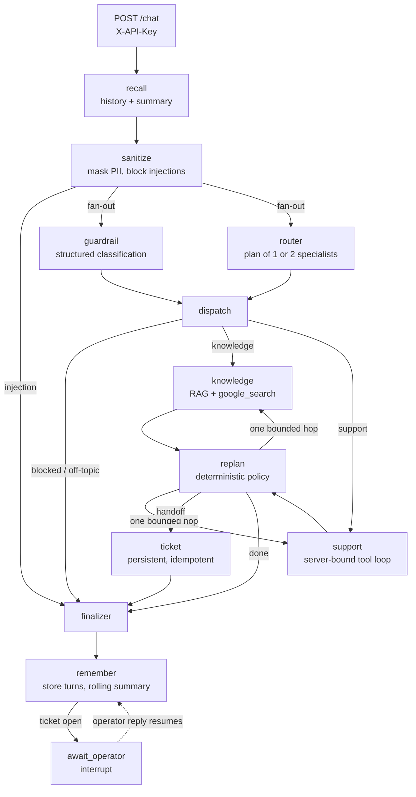

# Getnet Multi-Agent Support System

[](https://github.com/ChristianDuranBonilla/getnet-multi-agent-support/actions/workflows/ci.yml)

A containerized FastAPI service in which cooperating agents, orchestrated with LangGraph on Gemini (Vertex AI), answer merchant questions about Getnet products, resolve account and card-machine issues from the authenticated merchant's data, remember the conversation, and hand off to a human operator who can answer inside the same conversation. Built for the AI Hardcore Engineer challenge following Spec-Driven Development: [`SPEC.md`](SPEC.md) was written first and is the source of truth (Part I: the 60-minute core; Part II: Revision 2 after the evaluation feedback); [`CLAUDE.md`](CLAUDE.md) holds the coding conventions and the security invariants.

Demo video (9 min, recorded on Revision 1): https://youtu.be/vjVVIyTO0T8. The Revision 2 changes are described in the next section; tags `v1` and `v2` mark the two submissions.

## Contents

- [Revision 2: what changed and why](#revision-2-what-changed-and-why)
- [Quick start](#quick-start)
- [Architecture](#architecture)
- [Life of a request](#life-of-a-request)
- [Identity and security](#identity-and-security)
- [Memory and human in the loop](#memory-and-human-in-the-loop)
- [RAG pipeline](#rag-pipeline)
- [Agents and tools](#agents-and-tools)
- [Observability](#observability)
- [Testing and evaluation](#testing-and-evaluation)
- [Design principles](#design-principles)
- [Trade-offs and next steps](#trade-offs-and-next-steps)

## Revision 2: what changed and why

Revision 1 was evaluated with a structural security finding and a set of scope gaps. Each one is closed below with the evidence that proves it.

| Finding in Revision 1 | What Revision 2 does | Where |
|---|---|---|
| The model chose whose data a tool read: `user_id` was a tool argument produced by the LLM and executed as is | Tools have no identity parameter in the schema the model sees (`InjectedToolArg`, asserted on the wire declaration too); `run_tool` forwards only the arguments the tool declares, so an identity under any name (`user_id`, `merchantId`, `cnpj`, ...) never reaches a tool, and injects the authenticated merchant; the attempt is logged and reported as a `security_event` | `app/tools/support_tools.py`, `app/agents/support.py`, `tests/test_identity.py` |
| No caller authentication; the body `user_id` was trusted | `X-API-Key` per merchant, hashed at rest, constant-time compared, with scopes and revocation; the body `user_id` is verified against the principal (403 `identity_mismatch`); per-key rate limiting | `app/auth.py`, `data/api_keys.json`, `tests/test_identity.py` |
| Guardrail failed open when the classifier was unavailable | `GUARDRAIL_FAIL_MODE=closed` by default: templated unavailable reply, no specialist runs, security event recorded | `app/agents/guardrail.py`, `tests/test_guardrail.py` |
| No conversation memory | Merchant-owned conversations in SQLite with ownership checks, a bounded history window and a rolling summary; `conversation_id` in the API; LangGraph `SqliteSaver` checkpointer | `app/agents/memory.py`, `app/repositories/sqlite_repository.py`, `tests/test_memory.py` |
| Knowledge and Support never collaborated; no replanning | The Router emits a plan of up to two specialists; Support can request a hop at runtime through a no-I/O tool; a deterministic replanner enforces one bounded hop and merges the answers | `app/agents/replan.py`, `tests/test_replan.py` |
| Tickets lived in memory; no operator flow | Persistent tickets (idempotent on the turn's thread id), operator endpoints to list, claim and reply, graph `interrupt()` on escalation and `Command(resume=...)` when the operator answers; the merchant sees the reply in the conversation | `app/agents/escalation.py`, `app/main.py`, `tests/test_hitl.py` |
| Evaluation checked routing and keywords only; retrieval never measured | Golden reference answers, an evidence-based LLM judge (groundedness, correctness, relevance, usefulness, unsupported claims) with human calibration, recall@5/MRR/nDCG@5 on a held-out query set plus a measured distance threshold (off-topic queries), dense versus hybrid (BM25 + RRF) retrieval, results versioned under `evals/results/` | `evals/judge.py`, `evals/retrieval_eval.py`, `app/rag/lexical.py` |
| No CI, no lockfile, raw `user_id` in logs, no cost accounting | GitHub Actions (lint, tests, image build, credential-free smoke test), `requirements.lock`, pseudonymous `merchant_ref` in logs, tokens and estimated cost per request, `/ready` distinct from `/health`, optional OpenTelemetry export | `.github/workflows/ci.yml`, `app/observability.py` |

### Measured quality (Revision 2)

Numbers come from the files under `evals/results/` written on 2026-11-20 by `make eval` (in-process, Vertex AI `global`) and by `run_eval.py --api` against the running service. The judge and the latency vary from run to run with the endpoint; the files keep the exact run, including every answer and its evidence.

| Measure | Revision 1 | Revision 2 |
|---|---|---|
| Regression scenarios | 14/14 | 18/18 in-process (`2026-11-20-regression.json`) and 19/19 black-box over HTTP against the service started from scratch (`2026-11-20-regression-api.json`, the mode `scripts/evaluate.sh` uses), including the 403 on a foreign `user_id` and the operator round trip; scenario 14 (unknown merchant) has no API key, so over HTTP it is the 401 path of scenario 19 |
| Latency | median 5.9 s, 14 single-turn scenarios | in-process: median 6.9 s, p25 5.0 s, p75 9.3 s, max 16.1 s over 17 model-backed scenarios that now include a two-turn conversation, three hops and the forced-search retry; node medians guardrail 1.6 s, router 1.8 s, knowledge 2.5 s, support 6.5 s; 0 of 54 model calls past 20 s. Black-box: median 8.0 s, p75 11.7 s, max 29.4 s, 1 of 54 calls past 20 s. The `global` endpoint is noisy: an earlier run of the same day had the router stall for 57 s on one scenario, which the service turned into a fail-safe escalation (`low routing confidence` ticket) rather than an answer from memory, and a run on 2026-11-19 saw 9 of 54 calls stall past 20 s with the fallback model answering 7 of them and all scenarios still passing |
| Judge, grounded scenarios | not measured | in-process, 14 scenarios: groundedness 0.996 (min 0.95), correctness 1.0, relevance 1.0, usefulness 1.0; 4 policy scenarios correctness 1.0 (`2026-11-20-judge.json`). Black-box, 13 scenarios: groundedness 1.0, correctness 0.996, relevance 1.0, usefulness 1.0; 5 policy scenarios 1.0; the 403 scenario is verified by the runner, not scored (`2026-11-20-judge-api.json`) |
| Judge vs. human labels | not measured | the author labelled the 18 in-process answers from their evidence (`evals/results/human_calibration.json`, rendered by `python evals/calibration_sheet.py` into `CALIBRATION_SHEET.md`, labelled before reading the judge's scores): mean absolute error 0.025 on groundedness and 0.025 on correctness, the judge 0.025 more lenient than the author on both, pass/fail agreement on groundedness 18/18 (`python evals/judge.py --calibrate`). The disagreements are the ones a reader would expect: generic Android steps the terminal page does not state (human 0.8, judge 1.0), an example bank the page does not name (0.9 vs 0.95), "full amount" where the page mentions a discount fee (0.9 vs 1.0) |
| Retrieval, 24 held-out queries, dense | not measured | recall@5 0.917, MRR 0.793, nDCG@5 0.807 (`2026-11-20-retrieval.json`); before near-duplicate removal the same index scored MRR 0.744, nDCG@5 0.764 |
| Distance threshold (0.38) | chosen by inspection | measured on the same run: the best relevant chunk of every held-out query lies at cosine distance ≤ 0.281 (none lost), the best chunk of 8 off-topic queries (weather, recipes, football, phones, poetry, geography, physics, hotels) lies at ≥ 0.392, and 0 off-topic chunks pass the threshold |
| Retrieval, hybrid (BM25 + RRF) | not measured | recall@5 0.833, MRR 0.743, nDCG@5 0.725; dense stays the default. Several remaining "misses" are sibling pages that carry the same answer (`/crediario/` ranked above `/duvidas/crediario/`); the labels were not relaxed to hide that |
| Offline tests | 21 | 91 |

## Quick start

Requirements: Python 3.12, Docker with Compose, a GCP project with the Vertex AI API enabled and credits, and `gcloud` for local credentials. `scripts/setup_gcp.sh` prepares a fresh project end to end (APIs, local credentials, a least-privilege service account whose key lands in `.secrets/`, and a smoke test of the models): `PROJECT_ID=<your-project> bash scripts/setup_gcp.sh`.

### Credentials of the demo merchants

Every call to `/chat`, `/conversations` and `/tickets` carries an `X-API-Key` header. The keys of the three mock merchants are in [`evals/demo_keys.json`](evals/demo_keys.json): test fixtures for mock data, kept out of the Docker image and never served by the API (the UI asks you to paste one). Only their SHA-256 hashes are stored in `data/api_keys.json`. Operators authenticate the same way: either with the single `OPERATOR_API_KEY` from the environment (an empty value or the development placeholder never authenticates; `scripts/evaluate.sh` generates a random one into `.env` when none exists) or with a per-operator key stored in `data/api_keys.json` with the `operator` scope, which gives each operator their own `key_id` on the tickets they claim; the demo fixtures include one (`operator_demo`). `python scripts/issue_api_key.py issue <merchant_id>` (or `issue --operator`) prints a new random key once and stores its hash; `revoke <key_id>` revokes one, effective without a restart.

### Local

```bash
make install                                  # virtualenv from requirements-dev.lock
cp .env.example .env                          # set GOOGLE_CLOUD_PROJECT, OPERATOR_API_KEY (any secret), LOG_SALT
gcloud auth application-default login         # credentials for Vertex AI
make ingest-offline                           # Chroma + BM25 indexes from the versioned pages (about 1 minute)
make run                                      # http://localhost:8080  (UI at /, OpenAPI at /docs)
```

```bash
KEY=$(python -c "import json;print(json.load(open('evals/demo_keys.json'))['cliente1988'])")
curl -s localhost:8080/chat -H "X-API-Key: $KEY" -H 'Content-Type: application/json' \
  -d '{"message": "When will the money from yesterday'\''s sales be deposited?"}'
```

The response carries `conversation_id`; send it back in the next request to continue the conversation.

### One-command evaluation

The only input is a Google Cloud service-account key with `roles/aiplatform.user` on a project where Vertex AI is enabled: the one evaluators receive privately, or any of their own (nothing in the repository is tied to a particular project). It must never be committed. With Docker installed:

```bash
bash scripts/evaluate.sh /path/to/sa-key.json
```

The script writes a `.env` with a random operator credential and log salt when none exists, builds and starts the container, waits for `/ready`, then runs from inside the container the regression scenarios against the API (including the operator round trip; the merchant keys are passed through the environment, not baked into the image), the semantic judge over the answers and the retrieval metrics, and exits with 0 only when all three pass. The service stays up afterwards at `http://localhost:8080`; `docker compose down` stops it.

### Docker, step by step

```bash
mkdir -p .secrets && cp /path/to/sa-key.json .secrets/sa-key.json
docker compose up --build          # .env.example is used when .env is absent
curl -s localhost:8080/health      # {"status":"ok","index_chunks":347,"model":"gemini-3.8-flash","ready":true,...}
```

The image ships the cleaned pages under `data/raw/`; on first start the entrypoint builds the indexes into the `chroma-index` volume (embeddings need Vertex AI, so the index is never built at image build time and credentials never enter the image). Conversations, tickets and checkpoints live in the `app-state` volume. Without credentials the container still boots and `/ready` answers 503, which is what CI checks.

### Tests and evaluation

```bash
make test        # ruff check, ruff format --check, pytest (no network, no credentials)
make eval        # regression + judge + retrieval through the graph in-process; writes evals/results/
make eval-api    # regression + judge against a running service (black-box)
make lock        # regenerate requirements.lock and requirements-dev.lock
```

Mock merchants: `cliente1988` (Get Smart, active, a credit sale from yesterday pending deposit), `cliente2001` (Get Clássica, terminal offline on Wi-Fi), `cliente3050` (Get Mini, account under review, declined transactions).

## Architecture



Agents communicate through the LangGraph shared state (`app/state.py`, `AgentState`) and conditional edges (`app/graph.py`). Every node is a plain function that receives the state and returns a partial update; `trace`, `evidence` and `security_events` have additive reducers so parallel nodes append without conflicts. One graph run is one turn; durable memory lives in the conversation repository and is loaded by `recall`, which keeps the reducers simple and the ownership check explicit.

Why direct state passing rather than a queue or an event bus: the service is request/response with a bounded number of steps, so in-process orchestration gives a linear trace, no infrastructure and sub-millisecond hops. The one step that waits for a human is modelled with LangGraph's `interrupt`, which persists the turn in the checkpointer until the operator answers.

Why the Guardrail and the Router run in parallel: both are one structured-output call over the same sanitized message and neither depends on the other, so the graph fans out to both in one superstep and joins at Dispatch. This removed one sequential model call from every request (about two seconds at the model's lightest reasoning level).

Why the replanner is code and not a model: the decision after a specialist (finish, hop, escalate) is a policy. In code it is tested exhaustively, adds no latency and cannot be talked into anything by a prompt. It observes what the specialist left behind: a handoff, a hop request, a remaining plan step, the tool results (a failed merchant-data lookup or an account under review goes to a human whatever the model wrote) and the evidence itself: a Knowledge answer with neither a retrieved chunk nor web grounding behind it is an answer from the model's memory and is escalated instead of sent. The model still decides *when* a hop is useful, through the `request_product_knowledge` tool, and *what* to ask.

## Life of a request

`POST /chat` with `X-API-Key` of `cliente1988` and `{"message": "When will I be paid for yesterday's sales and how many instalments does crediário allow?"}`

1. **Authentication** resolves the key to `Principal(merchant_id="cliente1988", scopes=("chat",))`. A `user_id` in the body, if present, must equal it.
2. **recall** loads the last turns and the summary of the conversation (empty for a new one).
3. **sanitize** masks Luhn-valid card numbers and valid CPFs and checks injection patterns. No model call.
4. **guardrail** and **router** run in parallel. The Router returns `plan: ["support", "knowledge"]` because the question needs both the merchant's data and product knowledge.
5. **support** calls `get_settlement_status()`; the runtime injects `merchant_id="cliente1988"` from the principal. The tool returns the sales with ISO dates and today's date.
6. **replan** sees a remaining step in the plan, moves Support's answer into `partial_answers` and routes to **knowledge**, which retrieves the crediário FAQ and writes one combined answer.
7. **replan** again: nothing left, `hops == 1`, on to **finalizer**, which merges the sources of both specialists.
8. **remember** stores the merchant turn (sanitized) and the assistant turn; every tenth turn it refreshes the rolling summary.

Response (abridged):

```json
{
  "conversation_id": "cnv_8f3a1b2c4d5e", "turn": 1, "user_id": "cliente1988",
  "agent": "knowledge", "plan": ["support", "knowledge"], "hops": 1,
  "intent": "account_or_transaction", "guardrail": "ok",
  "response": "Your credit sale of R$ 450.00 from yesterday is scheduled for deposit on ... For crediário, each card issuer sets the maximum number of instalments ...",
  "confidence": 0.93, "handoff": false, "ticket_id": null,
  "sources": [{"type": "tool", "ref": "get_settlement_status"}, {"type": "rag", "ref": "https://site.getnet.com.br/duvidas/crediario/"}],
  "tool_calls": ["get_settlement_status"], "security_events": [],
  "usage": {"input_tokens": 4310, "output_tokens": 262, "estimated_cost_usd": 0.0029},
  "trace": [
    {"step": 1, "node": "recall", "ms": 2, "detail": "new conversation"},
    {"step": 2, "node": "sanitize", "ms": 0},
    {"step": 3, "node": "guardrail", "ms": 2900, "detail": "ok", "tokens_in": 410, "tokens_out": 24},
    {"step": 4, "node": "router", "ms": 3100, "detail": "support/knowledge/account_or_transaction", "tokens_in": 760, "tokens_out": 41},
    {"step": 5, "node": "support", "ms": 5400, "detail": "1 tool calls", "tokens_in": 1500, "tokens_out": 90},
    {"step": 6, "node": "replan", "ms": 0, "detail": "hop->knowledge"},
    {"step": 7, "node": "knowledge", "ms": 4200, "detail": "rag:1", "tokens_in": 1640, "tokens_out": 107},
    {"step": 8, "node": "replan", "ms": 0, "detail": "finalizer"},
    {"step": 9, "node": "finalizer", "ms": 0},
    {"step": 10, "node": "remember", "ms": 4, "detail": "2 turns"}
  ],
  "latency_ms": 12900
}
```

`include_evidence: true` in the request adds `evidence`: the retrieved chunks with their cosine distance, the tool results and the web grounding references. This is what the judge grounds against.

## Identity and security

The invariant is: **the model decides which operation runs, never on whose data.**

- **Principal.** `app/auth.py` builds a `Principal` from the `X-API-Key` header and nowhere else. Keys are stored as SHA-256 hashes with scopes and a status; comparison uses `hmac.compare_digest`; revoked keys get 403 `key_revoked`, unknown ones 401. Operator credentials (the environment key or stored keys with the `operator` scope) carry no merchant id; claims and replies are attributed to their `key_id`.
- **Server-bound tools.** Each merchant-data tool declares `merchant_id: Annotated[str, InjectedToolArg]`, so the parameter does not exist in the schema the model sees (a test asserts the schema is empty). `run_tool` is the only code path that executes a tool: it forwards only the arguments declared in the tool's call schema (an allowlist, so `merchantId`, `cnpj` or any other spelling is dropped, not just a fixed list of names), logs `identity_override_attempt` when a dropped argument looks like an identity (tool name and `key_id`, never the value) and `unexpected_tool_arguments` for the rest, and invokes the tool with the principal's merchant id. The attempt is also returned in `security_events` so evaluators and operators can see it.
- **Body identity is verified, not trusted.** The challenge contract `{message, user_id}` still works; a `user_id` that differs from the authenticated merchant is rejected with 403 `identity_mismatch` before the graph runs.
- **Ownership at the repository boundary.** Conversations and tickets are looked up by `(id, merchant_id)`; missing and foreign records both answer 404, so existence is never leaked. Operators, by contrast, see the merchant id and the sanitized summary of every ticket: that is their job, and PII is masked before anything is stored.
- **Rate limiting.** Token bucket per key (`RATE_LIMIT_PER_MINUTE`, `RATE_LIMIT_BURST`), 429 with `Retry-After`. In-process; a shared store is the production step.
- **Deterministic defenses first.** Card numbers and CPFs are masked before any model call; injection phrases end the request without a model call. The classifier runs second and, when it cannot run, the request fails closed (`GUARDRAIL_FAIL_MODE`).
- **Secure defaults.** No endpoint serves credentials; the demo keys are test fixtures excluded from the image; an empty or placeholder `OPERATOR_API_KEY` never authenticates (the operator endpoints simply reject until a real one is set); failed authentications are throttled per client address; `X-Request-ID` is accepted only when well formed and is never a security input.
- **Secrets and identifiers.** Credentials are mounted at runtime and never enter the image; logs carry `merchant_ref` (salted hash) and `key_id`, never the merchant id or a key; `LOG_SALT` and `OPERATOR_API_KEY` must be set outside development (a startup warning says so). Answers are passed through the same PII masking as inputs before they leave the service.

Production evolution, described not built: OIDC/JWT with the merchant's identity provider replacing the API key, with the same `Principal` as the boundary.

## Memory and human in the loop

**Conversations.** `ChatRequest.conversation_id` is optional: absent, a conversation is created for the principal; present, it must exist and belong to the principal (404 otherwise). `recall` loads the last `MEMORY_WINDOW_TURNS` exchanges and the rolling summary into the prompts of the Router, Knowledge and Support, so "It's the Smart." after "My card machine is offline." routes to Support with the terminal context. `remember` stores the sanitized merchant message (masked PII never persists; a message the guardrail blocked is stored as a marker so it cannot re-enter later prompts) and the answer; when `MEMORY_SUMMARY_EVERY` turns have accumulated since the last summary, a structured call writes a new 120-word summary, and if that call fails the cursor stays put so the turns are summarised next time. `GET /conversations/{id}` returns the turns and the summary to their owner. Storage is one SQLite file (`data/state/app.sqlite`, WAL mode); the graph itself is checkpointed by `SqliteSaver` with one thread per turn (`"{conversation_id}:{turn}:{random}"`, so concurrent or retried requests never share a checkpoint; the turn number is informational and two concurrent messages may both be numbered as the same turn). A parked turn survives a process restart: a test interrupts with one `SqliteSaver`, reopens the file with another and resumes.

**Operator loop.** When the replanner decides that a human is needed (a merchant-data tool failed, the account is under review, blocked or suspended, a Knowledge answer has no evidence, the specialist reported a model error or an empty answer), `ticket` opens a persistent ticket, idempotent on the turn's thread id (server-generated, never a client header), and composes the handoff notice; `remember` stores the turn; `await_operator` calls `interrupt()`, so the turn is parked in the checkpointer and the merchant gets the notice with `handoff: true`. An operator then:

```bash
OP=$(python3 -c "import json;print(json.load(open('evals/demo_keys.json'))['operator_demo'])")
curl -s "localhost:8080/tickets?status=open" -H "X-API-Key: $OP"
curl -s -X POST localhost:8080/tickets/TCK-3F9A1B/claim -H "X-API-Key: $OP"
curl -s -X POST localhost:8080/tickets/TCK-3F9A1B/reply -H "X-API-Key: $OP" \
  -H 'Content-Type: application/json' \
  -d '{"message": "We completed the review; transactions are enabled again.", "resolution": "resolved"}'
```

The reply resumes the parked turn with `Command(resume=...)`; `await_operator` returns the message, `remember` appends an `operator` turn, and the merchant sees it in `GET /conversations/{id}` (their own tickets are visible through `GET /tickets/{id}` with status, reply and resolution only) and in the history of their next message. `resolution: "needs_merchant"` leaves the ticket in `waiting_merchant` so the operator can answer again after the merchant replies; `"resolved"` closes it. Exactly-once: a resolved ticket cannot be replied to again (409 `already_resolved`), claims by another operator conflict (409 `already_claimed`), and the idempotent ticket node cannot open a second ticket for a replayed turn. Before resuming, the API checks that the thread is actually parked at `await_operator`; a later reply (the second one after `needs_merchant`, or one after a lost checkpoint) is appended to the conversation directly and the response says `resumed: false`, so no operator message is ever lost. **One ticket per cause.** A conversation never accumulates duplicate tickets: when the same cause (same `reason`) escalates again while a ticket is still open, claimed or waiting for the merchant, the merchant is pointed to that ticket (`existing_ticket` in the evidence) and the turn ends without a second wait for an operator. **A human decision stands.** Once an operator has resolved a ticket for a cause in the conversation, the replanner does not re-escalate for that cause even if the mock data still shows the account under review: the follow-up is answered from the operator's reply, which `recall` adds to the evidence (`type: operator`) so the judge can verify it.

## RAG pipeline

**Sources.** The challenge points at `getnet.net/en`, which is the group's corporate site and does not describe the Brazilian products the scenarios ask about (Get Clássica, Get Smart, Pix, antecipação, crediário). Those live on `site.getnet.com.br`, so the crawl seeds both: 18 FAQ sub-pages of the Brazilian help center, the product pages, and the English solution pages of the global site. Same-host links are followed one level deep, up to 70 pages, skipping legal, press, careers and language-root duplicates.

**Ingestion** (`app/rag/ingest.py`). Pages are fetched with `httpx`, cleaned with BeautifulSoup and stored as `data/raw/<slug>.txt` with a two-line header (`url`, `title`). The files are versioned so the indexes can be rebuilt offline (`make ingest-offline`, used by the Docker entrypoint). Last crawl: 70 pages; after stripping the header, help menu and footer that `site.getnet.com.br` repeats on every page, 401 chunks; after near-duplicate removal (`dedupe_chunks`: the FAQ hub `/duvidas/` republishes every category page and some product pages repeat their FAQ, so a chunk whose sentences are at least 90% present on a more specific page is dropped), 347 chunks. Removing the copies raised MRR from 0.744 to 0.793 on the held-out set because the owning page, not the hub, now ranks first. Chunks get deterministic ids (`<slug>-<n>`) shared by both indexes.

**Storage.** `RecursiveCharacterTextSplitter(800, 120)`; metadata `url`, `title`, `section`, `lang`. Embeddings from `gemini-embedding-2` (3072 dimensions, `RETRIEVAL_DOCUMENT` / `RETRIEVAL_QUERY` task types) in a Chroma collection with cosine distance, plus a BM25 index over the same chunks (`app/rag/lexical.py`, dependency-free, accent-folding tokenizer for Portuguese, English and Spanish) stored next to it.

**Retrieval and generation** (`app/rag/retriever.py`, `app/agents/knowledge.py`). `RAG_MODE=dense` queries the vector index; `hybrid` takes the top-20 of each index, fuses them with reciprocal rank fusion (k=60) and keeps the top-5. Every chunk carries its cosine distance either way, so the relevance threshold keeps its meaning: chunks under 0.38 form the context (on the held-out set the best relevant chunk scores 0.17 to 0.28; the best chunk of an unrelated question scores 0.39 and above, measured by `retrieval_eval.py`). The default mode is the one that wins on the held-out query set (see Measured quality). The model always has Gemini's native `google_search` tool bound for gaps the site does not cover; `sources` distinguishes `rag` and `web` references. A web source is reported only from grounding metadata: the result URIs when the endpoint attributes them, otherwise the search queries it executed (`google_search: <query>`); nothing is inferred from the answer text. The web evidence holds the answer text each result supports so the judge can check it. A world question that comes back without any grounding, or any answer whose search ran but returned only its queries and no result attribution (Gemini does that now and then; a run of 2026-11-20 scored 0.6 on groundedness for exactly that), is asked once more with the search made explicit before the sources are given up on. The "Sources:" block at the end of the answer text is written by the finalizer from those verified sources (page URLs; web results by the domain the grounding attributes them to, the redirect URI staying in the structured `sources`; a search without attribution by its query), and any list of URLs the model wrote itself is removed first, so a remembered URL never reaches the merchant.

## Agents and tools

| Node | Module | Model call | Role |
|---|---|---|---|
| recall / remember | `app/agents/memory.py` | structured (`ConversationSummary`), only when a summary is due | Load and store the conversation |
| sanitize | `app/agents/guardrail.py` | none | Mask card numbers and CPFs, block injection patterns |
| guardrail | `app/agents/guardrail.py` | structured (`GuardrailResult`) | Classify ok / off_topic / pii / unsafe / prompt_injection; fail closed |
| router | `app/agents/router.py` | structured (`RouterDecision`) | Plan of one or two specialists, intent and confidence |
| knowledge | `app/agents/knowledge.py` | chat + `google_search` | RAG over the index with web search; merges a partial answer on a hop |
| support | `app/agents/support.py` | chat + tools, at most 4 iterations | Resolve account, deposit and terminal questions on the principal's data; reports tool results, decides nothing about escalation |
| replan | `app/agents/replan.py` | none | Finish, hop once, or escalate; owns the escalation policy (failed tool, account under review, unsourced answer) |
| ticket / await_operator | `app/agents/escalation.py` | chat only when there is no partial answer | Open a persistent ticket, hand off, resume with the operator's reply |
| finalizer | `app/agents/finalizer.py` | none | Guarantee an answer, mask PII in it, merge the sources and append the verified sources block, add the PII notice |

**Support tools** (`app/tools/support_tools.py`), backed by the `SupportDataRepository` protocol with a JSON implementation: `get_user_profile()`, `get_settlement_status()` (includes today's date so "yesterday" is resolved against data), `get_terminal_status()`, all bound to the principal, and `request_product_knowledge(question)`, a no-I/O tool that asks for a Knowledge hop. Unknown merchants return `{"ok": false, "error": "user_not_found"}`; the replanner, not the model, turns a failed lookup or an `account_status` of `under_review`, `blocked` or `suspended` into a ticket (`ToolCall.account_status` is the policy input), so the escalation does not depend on what the model wrote.

**Gemini settings.** `gemini-3.8-flash` on Vertex AI location `global` with `thinking_level="low"` (the lightest level the model accepts), default temperature as Google advises for Gemini 3, a 30 s timeout with one SDK retry, one shared client per reasoning level and model. **Fallback model.** When the primary raises (timeout, 5xx from the endpoint, both observed on `global` during the evaluation runs) the same request goes once to `LLM_FALLBACK_MODEL` (`gemini-3.5-flash`, the only other Gemini 3 model this project is served); the model that answered is recorded per node in the trace (`model`), so a degraded endpoint shows up in the data instead of as a failed request. Structured output and `google_search` cannot be bound on the same model instance, which is why the Router and Guardrail never search and the Knowledge agent never uses structured output. Token usage is read from every response (`usage_metadata`, with `include_raw` for structured calls).

## Observability

- Every request gets a `request_id` (or honours `X-Request-ID`), echoed in the response header, and one JSON log line: `merchant_ref`, `key_id`, `conversation_id`, `turn`, `agent`, `plan`, `hops`, `intent`, `confidence`, `handoff`, `ticket_id`, `security_events`, tokens, `latency_ms`, `tool_calls`. No raw merchant id or key ever appears (a test captures the logs and checks).
- Every node is wrapped by `timed_node`, which appends `{node, ms, detail, tokens_in, tokens_out, model}` to the trace; the response carries the trace and `usage` with the estimated cost from the list prices in `.env.example`.
- `/health` is liveness and cheap (status, index size, model, a `ready` flag from in-memory checks); `/ready` is readiness (index present, a real write to the state directory, credentials configured) and is what the Docker healthcheck and `evaluate.sh` wait for.
- `GET /metrics` (operator scope) exposes in-process counters in the Prometheus text format: requests by path and status, turns by agent and handoff, latency sum, tokens by direction, security events by type and model calls by node and model; labels never carry a merchant identifier.
- Optional OpenTelemetry: set `OTEL_EXPORTER_OTLP_ENDPOINT` (and install the `otel` extra) to export one span per request and per node with the trace fields as attributes; nothing is imported when it is unset.
- Errors never leak tracebacks: a 500 envelope with the `request_id` for correlation.

The UI at `/` exposes the same data: a pasted merchant key (kept in the browser only), persistent conversation, plan, hops and hop question, tokens and cost, security events, sources, trace, and a collapsed operator panel that lists open tickets and replies to them.

## Testing and evaluation

**Unit and contract tests** (`tests/`, offline, under five seconds): the identity boundary (schemas without identity fields, override attempts bound to the principal and logged, 401/403/429 paths, body verification), guardrail policy including fail-closed, PII masking, memory (ownership, window, sanitized storage, rolling summary trigger, history reaching the Router), replanning (rule order, planned and requested hops, cap, handoff precedence), the operator loop (idempotent tickets, interrupt and resume with `InMemorySaver` and across a `SqliteSaver` restart, a late reply without a waiting thread, two operators and a claim conflict over the API, foreign ticket 404), the argument allowlist of `run_tool` and the wire schema sent to the model, the replanner's escalation policy and the standing operator decision, one ticket per cause, operator replies as evidence, the verified sources block and the forced-search retry, near-duplicate removal at ingest, the API contract, the log hygiene, ranking metrics, tokenizer, BM25 and RRF.

**Regression evaluation** (`evals/run_eval.py`, `evals/scenarios.jsonl`): the 10 challenge scenarios plus 10 more: prompt injection, a card number, an off-topic request, an unknown merchant, a two-turn conversation, a mixed question that needs both specialists, a hop requested at runtime, an identity override attempt in the message, a foreign `user_id` in the body (expects 403) and the operator round trip. Each scenario declares the expected first specialist (`expected_agent`) and, where a hop is expected, the specialist that writes the final answer (`expected_final_agent`), plus plan, hops, handoff, guardrail category, tools, source types, keywords that a correct answer must contain (never words echoed from the question) and forbidden strings. The runner works in-process or black-box against the API and writes `evals/results/<date>-regression.json` (`-regression-api.json` in black-box mode) with every answer and its evidence.

**Semantic evaluation** (`evals/judge.py`): every scenario has a hand-written `reference_answer`. A Gemini judge with structured output receives the question, the evidence, the reference and the answer, and scores groundedness, correctness, relevance and usefulness (0 to 1) and lists unsupported claims. Means are computed over the scenarios whose answer must be grounded; guardrail and HTTP-status scenarios are reported apart. Pass criteria: mean groundedness ≥ 0.85 and no grounded scenario under 0.6, mean correctness ≥ 0.8. `python evals/calibration_sheet.py` renders every answer with its evidence into `evals/results/CALIBRATION_SHEET.md`, the judge's own scores last in each block; `evals/results/human_calibration.json` is where the author labels the same answers (groundedness and correctness, from the evidence, without looking at the judge first) and `judge.py --calibrate` reports the mean absolute error and the pass/fail agreement, which is what turns the judge into a measurement; the labels are redone whenever the scenarios change.

**Retrieval evaluation** (`evals/retrieval_eval.py`, `evals/retrieval.jsonl`): 24 held-out queries in Portuguese, English and Spanish with their expected pages, plus 8 off-topic queries with none; recall@5, MRR and nDCG@5 for `dense` and `hybrid`, per language, and the distance gap around the threshold (best relevant distance, best off-topic distance, off-topic chunks that would enter the prompt). The winning mode is the default.

**CI** (`.github/workflows/ci.yml`): lint, tests, image build and a credential-free smoke test that asserts `/health` reports `ready: false`, `/ready` answers 503 and `/chat` answers 401. Vertex-backed evaluations run locally and in `scripts/evaluate.sh`; their results are committed under `evals/results/`.

## Design principles

| Principle | Where |
|---|---|
| Single responsibility | One node per module under `app/agents/`; prompts in `app/prompts/`; data access in `app/repositories/`; authentication in `app/auth.py`; model construction in `app/llm.py` |
| Dependency inversion | Agents call `llm.chat()` / `llm.structured()`, `rag.get_retriever()` and the repository factories through modules; tests replace them (`tests/conftest.py`) and run without network |
| Open/closed | Specialists are registered in `SPECIALISTS`; the replanner reads the plan; a new specialist is one entry plus a Router prompt line |
| Interface segregation | Three small `Protocol`s: merchant data, conversations, tickets; JSON and SQLite implementations today, a database tomorrow |
| Deterministic policy, probabilistic language | Routing caps, hop caps, escalation triggers, identity checks and rate limits are code with tests; models write text and pick among allowed operations |
| DRY | One `timed_node` decorator, one prompt loader, one identity boundary (`run_tool`), one error envelope, one place for model settings |

## Trade-offs and next steps

- **Index built at container start, not at image build.** Embeddings require Vertex credentials; keeping them out of the image is worth one slow first start.
- **API keys, not OIDC.** The boundary (`Principal`) is in place; swapping the credential for a JWT from the merchant's identity provider changes `app/auth.py` only.
- **One thread per turn.** Per-turn execution state and durable memory are kept apart on purpose; a thread per conversation would let the checkpointer carry memory but would need reset semantics for every per-turn field.
- **One hop, policy in code.** `MAX_HOPS=1` covers the mixed questions in the scenarios; raising it is a setting, and the replanner already carries the partial answers forward. The replanner reacts to what the specialist reported (tool results and their status, hop request, remaining plan, evidence), not to the quality of the text; re-querying on a weak answer would be the next adaptive step, and the judge is the instrument to decide whether it is needed.
- **In-process rate limiter, SQLite state.** Right for one instance; a shared store (Redis, Firestore, Postgres with the LangGraph Postgres checkpointer) is the multi-instance step.
- **Summary after the answer.** The rolling summary runs inside the same request after the answer exists, so it never delays the visible answer but it does lengthen every tenth request; a background task is the next step.
- **Vector store.** Chroma plus BM25 in a volume is right for this scope; Vertex AI Vector Search or AlloyDB with `pgvector`, plus a learned reranker, once the corpus grows.
- **Latency.** The floor is one classifier call plus one specialist call, about 4 to 6 s at `thinking_level="low"`; a hop adds one specialist call. The `global` endpoint stalls or answers 504 on a noticeable share of calls (one in fifteen in Revision 1; more during the Revision 2 runs); the 30 s timeout, one retry and the fallback model cap the worst case, and the trace shows which model answered. Hedged requests are the next step if the endpoint stays noisy.
- **Vertex AI location.** Gemini 3.x models are served from the `global` endpoint in this project; a product with Brazilian data-residency requirements would evaluate `southamerica-east1` with a model available there.
